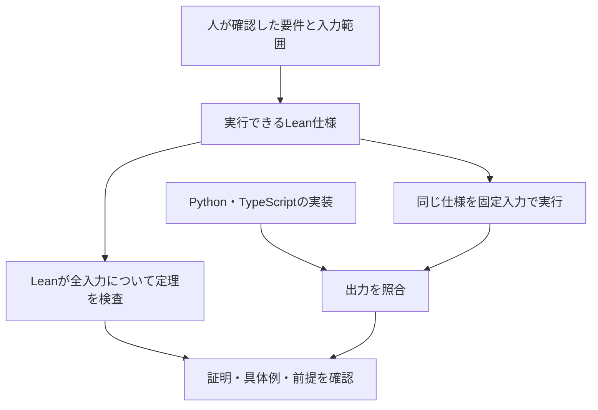

# Lean Code Assurance Lab

[English](README.md) · [全体設計](docs/architecture.ja.md) · [実験計画](docs/experiments.ja.md) · [参考文献](docs/sources.md)

AIが書いたコードをサービスに取り込むとき、どこまでなら根拠を持って信頼できるか。この研究では、Python・TypeScript・Rustのコードから一つの判断を取り出し、人が決めた仕様をAIエージェントがLeanで記述します。証明した性質と実際のコードの動作を、それぞれ追試できる形で残します。

## 最初の題材は予約の上限

定員が10、予約済みが7なら、3件の追加予約は受理して合計10を返し、4件なら拒否するのが仕様です。「定員を超えない」だけなら、全件を拒否するコードでも満たせます。そこで、**受理すべき条件と拒否すべき条件の両方**を書きました。

| 知りたいこと | 根拠を確認する場所 |
| --- | --- |
| どの自然数を入力しても、受理後の予約数は定員以下か | [Leanが検査する3つの定理](Reservation.lean)と[依存する公理の検査](Audit.lean) |
| Python・TypeScriptの実装も同じ答えを返すか | [各言語の実装](examples/reservation/)を[検証スクリプト](scripts/check.py)が各518入力で照合。満員ちょうどや大きな整数も含みます。 |
| 検証方法は境界条件の誤りに気づけるか | わざと「満員ちょうど」を拒否する実装を用意し、Leanの答えと食い違う入力を出力します。 |



## 自分で試す

Elanを含むLean環境、Python 3.10以上、Node.js 24以上を用意し、リポジトリのルートで次のコマンドを実行します。初回は固定版のLeanを取得することがあります。証明のビルド、公理の確認、2言語との照合が終わると、結果がJSONで表示されます。[Lean公式インストール手順](https://lean-lang.org/install/)

```sh
python scripts/check.py
```

Pythonのコマンド名が `python3` の環境では `python3 scripts/check.py` で実行できます。初回の公開実行では3定理が通り、両言語で各518件が一致し、境界を間違えた対照では40件の不一致が出ました。[記録したJSON](evidence/reservation-baseline.json)・[CIの実行履歴](https://github.com/moruku36/lean-code-assurance-lab/actions/workflows/assurance.yml)・[予約の例を読み解く手順](docs/walkthrough.ja.md)

## Lean 4の検証結果

- **レビュー比較**：[初回の未見比較](docs/stage-1-lean-pilot-results.md#日本語)の6件では、Leanを追加しても検出は増えませんでした。標準レビューにはまだ入れません。
- **巨大整数とページ分割**：[チェックポイントの検証](docs/checkpoint-page.ja.md)では、各言語54件のページ要求と、言語をまたぐ12件の走査が一致しました。ファイルの内容が変わると、古いカーソルは拒否されます。
- **一括走査**：合成データ1,000行の[実験](docs/checkpoint-walk.ja.md)では、同じ28ページを返しながら、Linuxでのファイルを開く回数が**28回から1回**になりました。処理時間は測っていません。
- **カーソルの引き継ぎ**：[Python・TypeScript間の40件](docs/checkpoint-handoff.ja.md)が期待値と一致しました。キーは十進文字列のまま渡します。JavaScriptの `Number` に変換すると丸められ、ファイルのハッシュが正しくても読んだ行が再表示される場合があります。
- **エージェントの検証ハーネス**：[Lean4Agentの論文メモ](docs/lean4agent.md#日本語)に、手順の構造・人が確認した条件・チェックポイントの実行結果を分けて見る考え方を整理しました。
- **Python・TypeScript・Rust**：[3言語共通の予約ハーネス](docs/lean4agent.md#3言語の共通検証)を追加。実行手順・Leanの仕様・各言語の出力を分けて確認し、2台での照合で各141件が一致しました。

Lean 4.19.0、Python、Node.jsを用意して、リポジトリのルートで再現できます。

```sh
python3 -B scripts/check_checkpoint_page.py
python3 -B scripts/check_checkpoint_walk.py
python3 -B scripts/check_checkpoint_handoff.py
```

証明の対象は型付きモデルです。パースやファイルの振る舞いは別途、具体例で検証しました。意図的に入れた誤りは通常のテストでも検出でき、本番でLeanの検出力が上がると分かったわけではありません。

## 自分のサービスへの進め方

| 対象 | このリポジトリでできること |
| --- | --- |
| Python・TypeScript | 両言語で予約・チェックポイントの例を再現できます。開発用の例と、今後の未見比較は分けて扱います。[実験計画](docs/experiments.ja.md) |
| Rust | 固定長整数を使う小さな関数を選び、AeneasでLeanに変換する実験を計画しています。[変換時に確認する前提](docs/architecture.ja.md) |
| 既存サービス | 一つの判定関数とその版、入力の契約、匿名化した例を持ち込む手順があります。[エージェントへの指示](AGENTS.md) |

今回の証拠が届くのは、モデルに書いた性質と、照合した入力での実装の振る舞いまでです。APIでの入力変換、同時予約、保守性、サービス全体のセキュリティには別の検証が必要です。[保証範囲の読み方](docs/architecture.ja.md)
