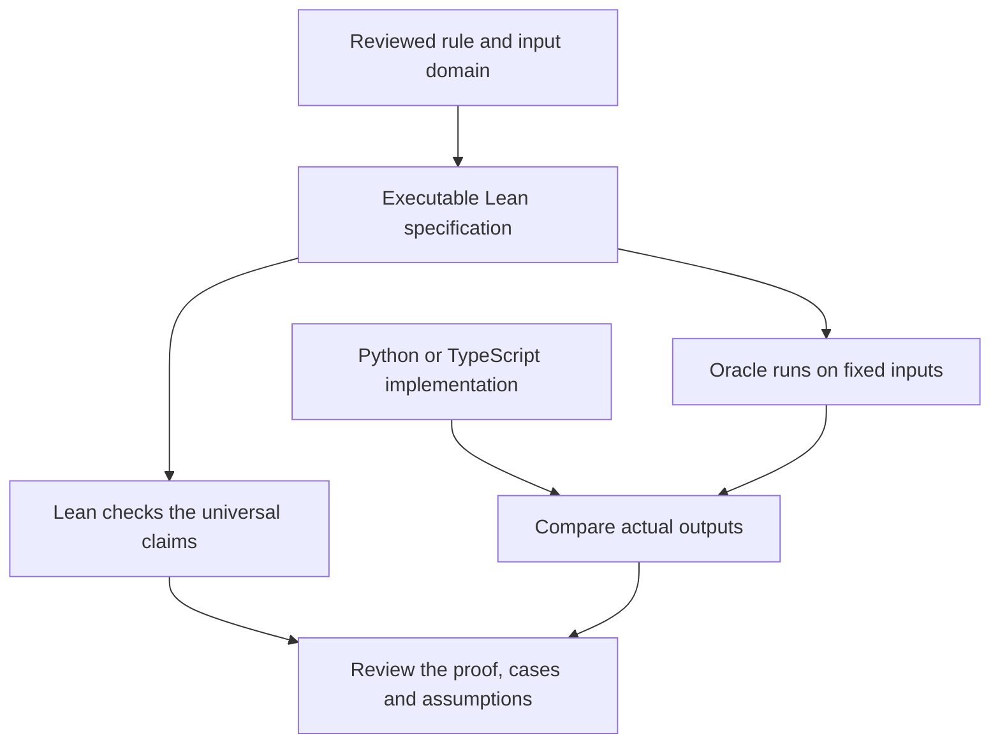

# Lean Code Assurance Lab

[日本語](README.ja.md) · [Architecture](docs/architecture.md) · [Research plan](docs/experiments.md) · [Reading list](docs/sources.md)

Can an AI agent use Lean to give a maintainer good reasons to trust a change to a Python, TypeScript or Rust service? This lab starts with one decision at a time. A maintainer states what must hold, an agent proposes a model and proof, and a repeatable check connects that model to the code people actually run.

## Start with a reservation

A service has capacity 10, has already allocated 7 units, and receives a request for 3. It should accept and return 10. A request for 4 should be refused. A system that rejects every request would stay under capacity while being useless. The Lean specification therefore covers **both what must succeed and what must fail**.

| Question | Where to see the evidence |
| --- | --- |
| Does every accepted reservation respect capacity, for all natural-number inputs? | [Three theorems checked by Lean](Reservation.lean) and [their axiom audit](Audit.lean) |
| Do the actual Python and TypeScript functions agree with the executable model? | [Both implementations](examples/reservation/) and [the runner](scripts/check.py) compare 518 fixed input triples per language, including exact fills and large integers. |
| Would the comparison notice a realistic mistake? | The runner changes the inclusive boundary to a strict one in a control implementation and prints a concrete disagreement. |



## Replay it

Install Lean with Elan, Python 3.10+ and Node.js 24+. From the repository root, run the following command. It builds the pinned Lean toolchain's project, inspects the proof dependencies, runs both implementations and prints a JSON evidence record. The first build can download Lean. [Lean installation](https://lean-lang.org/install/)

```sh
python scripts/check.py
```

On systems where Python is named `python3`, use `python3 scripts/check.py`. The first public run checked all three theorems, matched 518 cases per language and detected the incorrect boundary in 40 cases. Read the [recorded JSON](evidence/reservation-baseline.json), [current CI runs](https://github.com/moruku36/lean-code-assurance-lab/actions/workflows/assurance.yml) or the [guided walkthrough](docs/walkthrough.md).

## Where the research goes next

| Track | What you can use here |
| --- | --- |
| Python and TypeScript | A runnable example for both languages. The [next experiment](docs/experiments.md) compares ordinary tests with an agent using Lean on previously unseen changes. |
| Rust | A planned pilot on one safe, fixed-width function using Aeneas. The [architecture](docs/architecture.md) describes which translation assumptions a source-level claim would inherit. |
| An existing service | A protocol for bringing in one versioned decision function, its input contract and sanitized examples. The [agent instructions](AGENTS.md) define what counts as evidence. |

A passing run supports the named properties of the model and agreement on the recorded cases. The production adapter, concurrency, code readability and broader security each need their own claim or review. [Evidence boundaries](docs/architecture.md)
