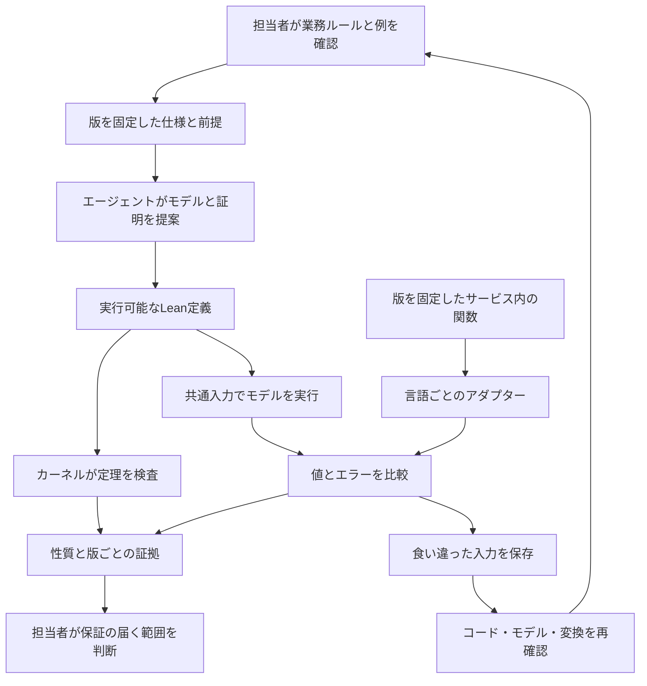

# 全体設計と保証範囲

[English](architecture.md) · [ホーム](../README.ja.md) · [実験計画](experiments.ja.md)

研究の単位は「特定の版の関数が、指定した入力範囲で満たす性質」です。たとえば「予約を受理したら返り値は加算後の予約数に一致し、定員以下になる」なら、定理にも実装の検査にもできます。セキュリティを扱う場合も、誰が、どの状態で、何を許されるかまで絞ります。

| 境界 | 確かめること | 予約での例 |
| --- | --- | --- |
| 業務要件 → 仕様 | 人が受理例、拒否例、入力と副作用の範囲を決めてからAIに渡す。 | `(10,7,3)` は10、`(10,7,4)` は拒否。使用量が上限以下なら追加0も受理。既に上限を超えている状態も定義する。 |
| 仕様 → Lean | 前提と結論を読み、固定版のLeanで定理と依存公理を検査する。 | 受理・拒否の両条件と、受理後の値が上限以下になる性質を、任意の自然数について証明する。 |
| Lean → 実行結果 | 証明が参照する関数を実行して期待値を得る。ここではコンパイラ、ランタイム、入出力変換を信頼する。 | 10進数の3値を読み、予約後の数または `reject` を返す。 |
| サービス → 対象実装 | 対象の版、数値の表現、値の正規化を記録する。クラッシュと業務上の拒否は区別する。 | Pythonは整数、TypeScriptは `bigint`。10進テキストで2⁵³を超える値も渡す。負数や不正な入力は今回の仕様の外。 |
| 証拠 → 採用判断 | 定理、照合した範囲、反例、版、未確認部分をまとめる。変更後は再実行する。 | 成功時にはJSONを出力。不一致なら入力と両方の値を表示して停止し、ビルドや実行環境のエラーは別の診断を出す。 |

## どの結果から何が言えるか

- **証明が通った**。記載した前提の下で、そのLean定義は定理を満たします。定理が業務要件を表すかは人が確認します。
- **実装が照合を通った**。対象の版は記録した入力でLeanと同じ出力を返しました。未検査の入力、ランタイム、並行実行は個別に扱います。
- **ソースに結び付いた証明**。将来のRust実験では変換された関数を証明し、変換器の版、対象言語の意味論、オーバーフロー、パニック、外部関数を前提として記録します。
- **運用・保守の品質**。可読性、ログや認証の組み込み、デプロイ後の挙動には、それぞれレビューや統合テストの結果を添えます。

## 自分のサービスを持ち込むとき

1. コミットを固定し、「予約を受け付けるか」「ある利用者がある資料を読めるか」のような判定関数を一つ選びます。誰が入力を用意し、どこで副作用が起きるかを書きます。
2. 隔離したテスト用の作業コピーから既存関数を薄いアダプター経由で呼び出します。匿名化した例を用意し、欠損値、拒否、例外、タイムアウト、丸めの扱いを決めます。
3. テナント分離なら主体・テナント・資源・操作を定義します。判定が正しいこと、HTTPで本人のIDと結び付くこと、DBで実際に制限されることには、それぞれ根拠が要ります。
4. その版で確認できた範囲を記録します。単一予約の証明を同時予約へ広げるには、トランザクションと並行実行のモデル、または統合実験を追加します。

TypeScriptの実サービスが `number` を使う場合は安全に表現できる範囲を決めます。Rustの初回候補は安全な `u64` 関数です。オーバーフロー時の仕様を定め、Aeneasとその前段の変換器を固定し、生成されたLeanを残します。未対応の構文や意味の対応が取れない箇所は、そのまま未解決として記録します。[Aeneas開発元](https://github.com/AeneasVerif/aeneas)
