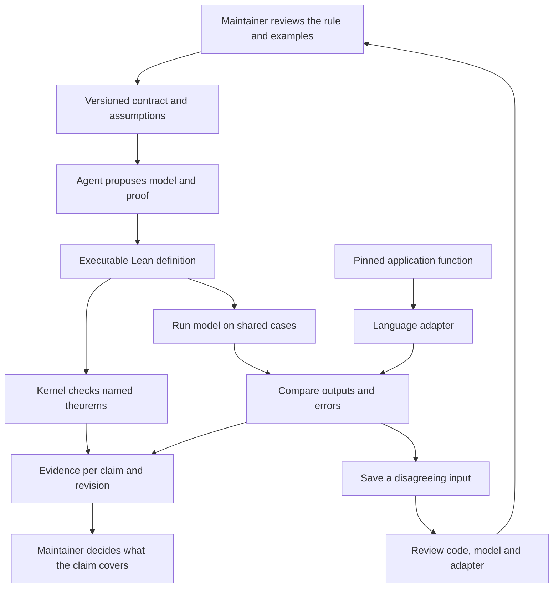

# Architecture and evidence

[日本語](architecture.ja.md) · [Home](../README.md) · [Study design](experiments.md)

The unit of work is a claim about a particular revision and input domain. For example, “a successful reservation returns the exact new usage and respects capacity” can guide both a proof and a check of the implementation. “This service is secure” leaves the actors, state, effects and assumptions open.

### What crosses each boundary

| Boundary | Obligation | Reservation example |
| --- | --- | --- |
| Intent → contract | A human chooses both an allowed and a refused example, the domain and the scope of effects. Review before letting the proving agent revise the model. | `(10,7,3) → 10` and `(10,7,4) → reject`. Zero-size requests are allowed when usage is within capacity. Even an already-overfull state is defined. |
| Contract → Lean | State the universal property. Inspect the theorem and its assumptions, build with a pinned toolchain, and audit the axioms used by each reported theorem. | `accept_if_fits`, `reject_if_exceeds` and `accepted_within_capacity` quantify over `Nat`. |
| Lean → executable oracle | The runner invokes the compiled definition used in the theorems. Execution also trusts compilation, the runtime and the input/output adapter. | Decimal triples on stdin. Each output is a decimal total or `reject`. |
| Service → implementation under test | Record the exact source revision, data representation and normalization. Preserve refusal and distinguish it from a crash or a missing output. | Python integers and TypeScript `bigint` represent the chosen naturals. Decimal text preserves values above 2⁵³. Negative and malformed inputs are outside the public contract for this case. |
| Evidence → decision | Keep the theorem, tested domain, counterexamples, versions and uncovered behavior together. Rerun on changes to the model, runtime or implementation. | One JSON record per successful run. A disagreement fails the command with the input and both results; build and process errors have separate diagnostics. |

### What a maintainer can claim

| Evidence | Legitimate conclusion | Remaining assumptions |
| --- | --- | --- |
| Checked theorem | The named proposition holds for the Lean definitions and listed hypotheses. | The spec expresses the intended rule; the pinned checker and its accepted axioms are trusted. |
| Executable agreement | The versioned implementation matched the executable spec on the listed inputs. | Untested inputs, the adapter, compiler/runtime behavior, I/O and deployment can differ. |
| Source-linked proof (planned) | A theorem applies to a translated function under the recorded source semantics and translation assumptions. | Record supported features, translator revision, integer/overflow behavior, panic paths and any external functions. |
| Review or operational test | Reviewers may assess readability, logging, authentication integration or deployment behavior using separate evidence. | Each statement needs a stated method, environment and scope. |

### Connecting a real service

1. Pin one source commit. Start with a pure decision such as whether a reservation fits or whether a role may read one resource. State who supplies the inputs and where effects happen.
2. Import the existing function through a thin adapter in an isolated test checkout. Use anonymized fixtures. Capture nulls, refusals, exceptions, timeouts and rounding according to a written contract.
3. For a property such as tenant isolation, specify the principal, tenant, resource and permitted action. A theorem about a decision function still leaves identity binding and enforcement at the HTTP/database boundary to integration checks.
4. Record evidence for that revision. An atomic model of a single request says nothing about two database writes interleaving. Add transactions and a concurrency model or run an integration experiment before extending that claim.

### Language adapters

Python and TypeScript share the same protocol in the worked case. Porting an existing service requires recording its actual numeric type; a TypeScript `number` endpoint would need an explicit safe domain or a different adapter. The Rust pilot will start with a small safe `u64` function, define checked-overflow behavior, retain the translated Lean artifact and pin Aeneas and its extraction front end. Unsupported constructs or missing semantic links remain open obligations. [Aeneas project](https://github.com/AeneasVerif/aeneas)
